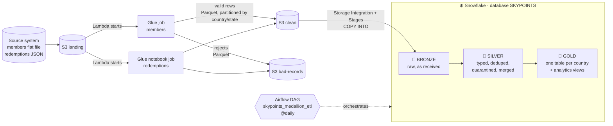
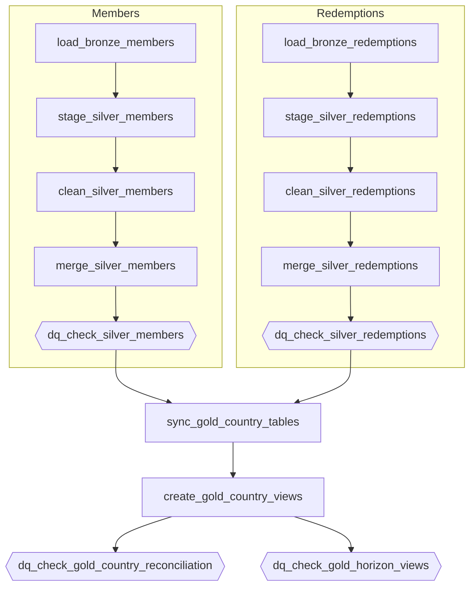

<div align="center">

# ✈️ SkyPoints

### A medallion data pipeline for a global airline loyalty program

*Millions of members. Many countries. Two messy daily feeds.*
*One clean, country-by-country picture of who is flying and who is redeeming.*


</div>

---

## 🛫 The mission

SkyPoints is a (fictional) global loyalty program: every member holds a **Membership Card** that opens partner lounges worldwide, redeems miles and tracks tier status (`SLV` → `GLD` → `PLT`).

Every day the source system drops two feeds on our runway:

| Feed | Shape | What's inside |
|---|---|---|
| **Member profile** | Pipe-delimited flat file (`\|H\|` header, `\|D\|` detail rows) | Name, ID, enrollment & last-flight dates, tier, agent, state, country, DOB, active flag |
| **Mileage redemptions** | Semi-structured JSON from partner airlines | One document per member with an array of redemption transactions |

The data arrives the way real data does: blank names, impossible dates, duplicate IDs, members who *moved country*, and transactions whose status flips from `PENDING` to `COMPLETED` days later. This repo turns that turbulence into trustworthy, per-country tables and analytics, **every day, without babysitting**.

---

## 🗺️ Flight plan (architecture)



**Why a medallion?** Each layer has exactly one job, so when something looks wrong you know where to look:

| Layer | Job | Rule of thumb |
|---|---|---|
| 🥉 **Bronze** | Land Parquet from S3 as received, add `load_timestamp`, pull `country` / `state` / `feed_date` out of the S3 path | *Never lose a row.* Dates and flags stay as raw strings. |
| 🥈 **Silver** | Parse dates safely, derive `age` and `stale_member`, quarantine bad rows with a reason, deduplicate, `MERGE` into the master tables | *Latest record wins.* |
| 🥇 **Gold** | One table per country (`gold.table_ind`, `gold.table_usa`, …) plus engagement analytics | *Ready for people to query.* |

---

## 🧠 The interesting engineering

### 1. "Latest record wins": even when a member moves country
A member can show up in two country partitions. Silver picks one winner per `member_id` (latest `last_flight_date`, then latest `load_timestamp`) and `MERGE`s it in only if it is at least as recent as what's already stored. When the country changes, the state is reset to the new one rather than inherited from the old one.

Gold then does the housekeeping: it **deletes the member from their old country table** before upserting into the new one, so nobody is ever counted in two countries.

### 2. Bad data is quarantined, not silently dropped
Rows that fail validation are moved to `bronze.members_bad_records` / `bronze.redemptions_bad_records` with an **`error_reason`** column that lists every rule broken (e.g. `FLIGHT_BEFORE_ENROLLMENT; INVALID_TIER_CODE`), so data stewards can fix problems at the source.

<details>
<summary><b>Member rules</b></summary>

| Rule | Error code |
|---|---|
| Name missing or longer than 255 chars | `INVALID_OR_NULL_MEMBER_NAME` |
| ID missing, ≤ 0, or longer than 18 digits | `INVALID_OR_NULL_MEMBER_ID` |
| Enrollment date missing or unparseable | `NULL_OR_INVALID_ENROLLMENT_DATE` |
| Last flight earlier than enrollment | `FLIGHT_BEFORE_ENROLLMENT` |
| Last flight in the future | `FUTURE_LAST_FLIGHT_DATE` |
| Tier not in `SLV` / `GLD` / `PLT` | `INVALID_TIER_CODE` |
| Agent name over 255 chars | `AGENT_NAME_TOO_LONG` |
| State or country over 5 chars | `INVALID_STATE_LENGTH` / `INVALID_COUNTRY_LENGTH` |
| DOB in the future | `FUTURE_DOB` |
| Active flag not `A` / `I` | `INVALID_IS_ACTIVE_FLAG` |

</details>

<details>
<summary><b>Redemption rules</b></summary>

| Rule | Error code |
|---|---|
| Member ID missing, non-numeric or ≤ 0 | `INVALID_OR_NULL_MEMBER_ID` |
| Transaction ID not matching `RX…` | `INVALID_OR_NULL_TXN_ID` |
| Transaction date missing or in the future | `NULL_OR_INVALID_TXN_DATE` / `FUTURE_TXN_DATE` |
| Partner missing | `NULL_OR_EMPTY_PARTNER` |
| Miles missing or ≤ 0 | `INVALID_MILES_REDEEMED` |
| Status not `COMPLETED` / `PENDING` / `CANCELLED` | `INVALID_STATUS` |
| Feed date earlier than transaction date | `FEED_DATE_BEFORE_TXN_DATE` |

</details>

### 3. Built to run incrementally
Silver never re-reads history. A watermark per source table lives in `bronze.ingestion_control`; each run only picks up Bronze rows with a newer `load_timestamp`, then advances the watermark. Everything downstream is set-based SQL (`MERGE`, window functions), and the member Parquet is partitioned by `country/state` (redemptions by `feed_date`), so the design scales out with the feed instead of looping over rows.

Silver masters are also clustered for their access paths: `silver_members` by `(country, member_id)` and `silver_redemptions` by `(txn_date, member_id)`.

### 4. Redemptions are living records
A transaction that was `PENDING` yesterday may be `COMPLETED` or `CANCELLED` today. The redemption merge updates an existing `txn_id` when status, miles or partner changed *and* the incoming feed is at least as recent, otherwise it's left alone. Late, out-of-order feeds can't overwrite fresher data.

### 5. Quality gates that stop the line
The Airflow DAG doesn't just run SQL, it **refuses to publish bad data**. After each Silver merge and after Gold is built, `SnowflakeCheckOperator` tasks assert things like:

- Silver tables are non-empty and `member_id` / `txn_id` are unique
- No member has a flight before enrollment, a future flight date or an unknown tier
- No redemption has zero/negative miles, a future date or an unknown status
- **Reconciliation:** Silver member count = sum of Gold country views, and one Gold table exists per country
- Horizon windows are monotonic (5-year miles ≥ 1-year miles ≥ 90-day miles)

### 6. Per-country tables that create themselves
New country in the data? No DDL ticket needed. `gold.sp_sync_country_member_tables` loops over the distinct countries in Silver and `CREATE TABLE IF NOT EXISTS gold.table_<country>` on the fly, then relocates and upserts members.

---

## ⏱️ The daily orchestra



`skypoints_medallion_etl` runs `@daily`, with two retries (3-minute delay), `max_active_runs=1` and `catchup=False`. The members and redemptions tracks run **in parallel** and meet at the Gold step.

---

## 📊 What you get out the other end

| Object | What it answers |
|---|---|
| `gold.table_<country>` | The authoritative member list for each country (e.g. `table_ind`, `table_usa`, `table_au`) |
| `gold.vw_member_horizon_summary` | Per member: days since last flight, redemptions over 30d / 90d / 1y / 5y and lifetime, active partners, and an **engagement segment** (`HIGHLY_ACTIVE_30D` → `ACTIVE_90D` → `COOLING_1Y` → `DORMANT_OVER_1Y`) |
| `gold.vw_country_wise_analysis` | Per country: members, stale members (> 90 days without a flight), tier mix, average age, redemption penetration, miles completed vs pending |
| `gold.vw_country_horizon_analysis` | Per country: flyers, redeemers and miles across the same time horizons |
| `gold.vw_table_<country>_horizon_summary` | The member horizon summary, pre-split for each country |

Joining redemptions back to profiles is a plain `LEFT JOIN` on `member_id`, so members with no redemptions still show up (with zeroes) instead of vanishing.

```sql
-- Who are our most engaged Platinum members in India right now?
SELECT member_name, state, completed_miles_90d, engagement_segment
FROM   skypoints.gold.vw_table_ind_horizon_summary
WHERE  tier_code = 'PLT'
ORDER  BY completed_miles_90d DESC
LIMIT  10;
```

---

## 🧳 Data contract

**Member flat file**

```
|H|Member_Name|Member_Id|Enrollment_Date|Last_Flight_Date|Tier_Code|Agent_Name|State|Country|DOB|Is_Active
|D|Elena|223457|20101012|20121013|GLD|Sam|CA|USA|03051985|A
```

| # | Column | Length | Type | Mandatory |
|---|---|---|---|---|
| 1 | Member Name | 255 | VARCHAR | **Y** (key) |
| 2 | Member ID | 18 | VARCHAR | **Y** |
| 3 | Enrollment Date | 8 | DATE (`YYYYMMDD`) | **Y** |
| 4 | Last Flight Date | 8 | DATE | N |
| 5 | Tier Code | 5 | CHAR | N |
| 6 | Agent Name | 255 | CHAR | N |
| 7 | State | 5 | CHAR | N |
| 8 | Country | 5 | CHAR | N |
| 9 | Post Code | 5 | INT | N |
| 10 | Date of Birth | 8 | DATE (`DDMMYYYY`) | N |
| 11 | Active Member | 1 | CHAR | N |

Silver parses dates defensively (`TRY_TO_DATE`, accepting `YYYYMMDD` and `YYYY-MM-DD`; DOBs are left-padded, since `3051985` is really `03051985`) so one bad date becomes a quarantined row instead of a failed load.

**Redemption JSON**

```json
{
  "member_id": "223457",
  "feed_date": "20240115",
  "redemptions": [
    { "txn_id": "RX10091", "txn_date": "20240110", "partner": "AeroLink",  "miles_redeemed": 12000, "status": "COMPLETED" },
    { "txn_id": "RX10092", "txn_date": "20240113", "partner": "SkyPoints", "miles_redeemed": 5000,  "status": "PENDING" }
  ]
}
```

---

## 🗂️ Repository map

```
SkyPoint/
├── AWS/
│   ├── Glue/
│   │   ├── skypointsmembersjob.py              # PySpark: split members into clean vs bad, write Parquet
│   │   └── Skypoints Redemption Notebook.json  # Glue notebook job for the redemption feed
│   └── Lambda/
│       ├── Skypoints_Lambda_Member.py          # starts the members Glue job (handles "already running")
│       └── Skypoints_Lambda_Redemption         # starts the redemptions Glue job
├── s3/
│   ├── 01_create_buckets (1).ipynb             # create landing / archive / rejects buckets
│   └── 02_upload_files.ipynb                   # upload feeds byte-for-byte, then verify size + line counts
├── Snowflake/
│   ├── Bronze/   Storage_Integration · Stages · Tables · Stored_Procedures
│   ├── Silver/   Tables · Views · Stored_Procedures   (load → clean → merge)
│   └── Gold/     Tables · Views · Stored_Procedures   (country sync, horizon views)
├── Airflow/
│   └── skypoints_medallion_etl.py              # the daily DAG with built-in DQ gates
└── Data/SampleData/                            # IND / USA / AUS sample files (inconsistent headers, bad dates)
```

---

## 🚀 Getting started

**You'll need:** an AWS account, a Snowflake account (the pipeline assumes a database called `SKYPOINTS` with `BRONZE`, `SILVER` and `GOLD` schemas) and an Airflow environment with the Snowflake provider installed.

1. **Create the buckets.** Open `s3/01_create_buckets (1).ipynb`. Export `AWS_ACCESS_KEY_ID` and `AWS_SECRET_ACCESS_KEY` in your shell first, change the `yourname123` suffix (bucket names are global) and make sure your region is enabled.
2. **Upload the feeds** with `s3/02_upload_files.ipynb`. Files must be named `SkyPoints_Members_YYYYMMDD.txt` and `SkyPoints_Redemptions_YYYYMMDD.json`.
3. **Deploy the AWS side.** Create the Glue jobs from `AWS/Glue/`, then the two Lambdas from `AWS/Lambda/`. Each Lambda reads its Glue job name from a `JOB_NAME` environment variable.
4. **Connect Snowflake to S3.**
   - Put your own role in `Snowflake/Bronze/Storage_Integration/SI.sql` and the buckets you created in `Stages.sql`.
   - Run `DESC STORAGE INTEGRATION skypoints_s3_int;` and use its values to finish the IAM trust policy.
5. **Build the objects, in layer order:** Bronze tables → Silver tables → Gold tables → all stored procedures.
6. **Seed the watermarks:**
   ```sql
   INSERT INTO skypoints.bronze.ingestion_control (table_name, last_load_timestamp)
   VALUES ('MEMBERS_CLEAN', '1900-01-01'), ('REDEMPTIONS_CLEAN', '1900-01-01');
   ```
7. **Create the analytics views.** After your first Silver load, run these once. The DAG's Gold checks read the views they create:
   ```sql
   CALL skypoints.gold.sp_sync_country_member_tables();
   CALL skypoints.gold.sp_refresh_gold_views();
   ```
8. **Schedule it.** Drop `Airflow/skypoints_medallion_etl.py` into your DAGs folder, create a Snowflake connection called `snowflake_default`, and unpause `skypoints_medallion_etl`.

> 🔐 **Never commit credentials or account-specific identifiers.** Keep AWS keys in environment variables (the notebooks already read them from there) and treat role ARNs and account IDs as configuration, not code.

---

## 🧭 Design decisions at a glance

| Decision | Why |
|---|---|
| Parquet between Glue and Snowflake | Compact, typed, splittable, and loads in parallel |
| Partition by `country/state` in S3 | Country and state come from the path, so they're never lost to a bad column |
| Raw strings for dates and flags in Bronze | A bad value can never block ingestion; Silver decides what's valid |
| Quarantine tables with `error_reason` | Auditable, fixable at source, nothing silently vanishes |
| Watermark + `MERGE` | Incremental, idempotent, safe to retry |
| Dynamic per-country DDL | New markets need zero code changes |
| DQ gates inside the DAG | Bad data stops the pipeline instead of reaching dashboards |

---

## 🛣️ Next on the runway

- Unit tests for the validation rules and the merge logic (including a member moving countries)
- CI to lint SQL and the DAG on every push
- Parameterise bucket names and role ARNs through a single config
- Automated alerting on quarantine volume spikes
- A dashboard on top of the Gold views

---

<div align="center">

Built with ☕ and a healthy distrust of clean-looking data by **Iishaan Kaushik**

*Cleared for landing.* 🛬

</div>
